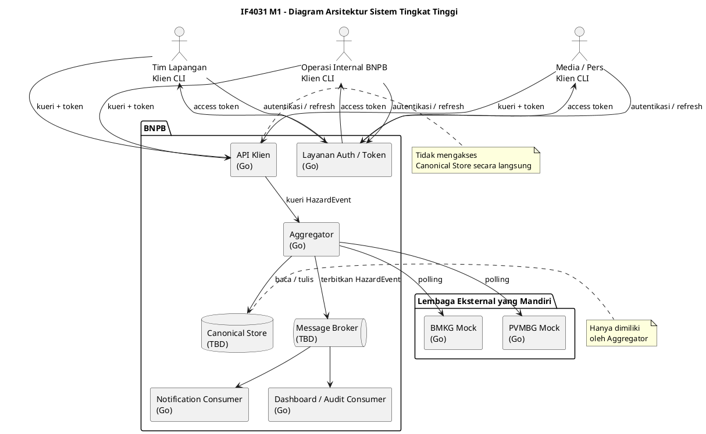

# Arsitektur Sistem

## 1. Gambaran Umum

Dokumen ini menjelaskan arsitektur tingkat tinggi sistem koordinasi bencana terdistribusi IF4031 Milestone 1.

Sistem ini mengintegrasikan dua penyedia informasi bencana yang berdiri sendiri:

- BMKG, yang menyediakan data kejadian seismik dan peringatan tsunami.
- PVMBG, yang menyediakan laporan aktivitas vulkanik.

BNPB berperan sebagai lapisan koordinasi. Sistem mengambil data dari kedua lembaga secara berkala, menormalisasi data sumber yang beragam ke dalam representasi kanonis `HazardEvent`, menyimpan event yang dihasilkan, menyediakan data bagi klien downstream, dan mendistribusikan event baru ke consumer yang berjalan secara mandiri.

Semua layanan backend khusus dikembangkan dengan **Go**.

Arsitektur ini menetapkan batas layanan yang jelas agar implementasi Milestone 1 dapat dikembangkan dan ditingkatkan skalanya pada Milestone 2 tanpa menambah kompleksitas Milestone 1 secara berlebihan.

---

## 2. Tujuan Arsitektur

Arsitektur ini dirancang dengan tujuan berikut:

1. Menetapkan batas layanan yang jelas antara komponen mandiri.
2. Mencegah ketergantungan langsung antara BMKG, PVMBG, BNPB, dan klien downstream.
3. Memungkinkan setiap layanan dijalankan, dihentikan, dibangun ulang, dan di-deploy secara mandiri.
4. Memastikan setiap penyimpanan data persisten hanya dimiliki oleh satu layanan.
5. Mendukung perubahan skema dari layanan upstream tanpa mengharuskan perubahan terkoordinasi.
6. Mencegah layanan upstream yang lambat atau tidak tersedia menghambat permintaan lain.
7. Memisahkan autentikasi dan domain kepercayaan BMKG, PVMBG, serta klien downstream BNPB.
8. Mendukung distribusi asinkron data `HazardEvent` baru.
9. Menjaga Milestone 1 tetap sederhana sambil mempertahankan batas yang dapat mendukung penskalaan horizontal di kemudian hari.
10. Menggunakan Go secara konsisten pada layanan backend khusus untuk mengurangi kompleksitas pengembangan dan operasional.

---

## 3. Batasan Arsitektur dari Spesifikasi

### 3.1 Komunikasi Berbasis Jaringan

Komunikasi antara BMKG, PVMBG, komponen BNPB, dan klien harus menggunakan panggilan jaringan seperti REST, gRPC, atau message broker.

Pemanggilan fungsi langsung lintas layanan dan penggunaan pustaka logika bisnis bersama tidak diperbolehkan.

### 3.2 Layanan Mandiri

Setiap layanan harus:

- berjalan di kontainer Docker sendiri;
- memiliki Dockerfile sendiri;
- dapat dijalankan dan dihentikan secara mandiri;
- berkomunikasi dengan layanan lain melalui jaringan.

Seluruh sistem harus dapat dijalankan dengan alat orkestrasi seperti:

```bash
docker compose up
```

### 3.3 Kepemilikan Penyimpanan

Setiap sistem penyimpanan hanya boleh memiliki satu layanan pemilik.

Canonical Store dimiliki oleh Aggregator.

API Klien tidak boleh mengakses Canonical Store secara langsung.

API Klien harus mengambil data Canonical Store melalui API Aggregator.

### 3.4 Ingesti Berbasis Polling

BMKG dan PVMBG merupakan layanan pasif.

Keduanya tidak mengirim event baru ke BNPB.

Aggregator melakukan polling ke kedua layanan secara berkala dengan interval yang dapat dikonfigurasi.

### 3.5 Distribusi Event

Setiap `HazardEvent` baru harus diterbitkan ke message broker.

Consumer yang berjalan secara mandiri berlangganan event tersebut.

Aggregator tidak boleh memanggil setiap consumer secara sinkron satu per satu.

### 3.6 Pemisahan Domain Kepercayaan

Kredensial untuk BMKG, PVMBG, dan klien downstream BNPB berada di domain kepercayaan yang terpisah.

Kredensial yang valid untuk satu lembaga tidak boleh otomatis memberikan akses ke lembaga lain.

---

## 4. Teknologi Dasar

### 4.1 Bahasa Pemrograman

Semua layanan backend khusus menggunakan:

```text
Go
```

Layanan tersebut mencakup:

- BMKG Mock;
- PVMBG Mock;
- Aggregator;
- Client-Facing API;
- Auth / Token Service;
- Notification Consumer;
- Dashboard / Audit Consumer.

Penggunaan satu bahasa backend mengurangi:

- keragaman alat build;
- duplikasi konfigurasi pengembangan;
- perbedaan image Docker;
- beban onboarding antaranggota tim.

### 4.2 Versi Go

Versi Go yang digunakan harus ditetapkan sebelum implementasi dimulai.

```text
Go version: 1.27.1
```

Semua layanan sebaiknya menggunakan versi Go yang sama, kecuali ada alasan kuat untuk berbeda.

### 4.3 Framework HTTP

Framework HTTP belum ditentukan.

Pilihan yang dapat dipertimbangkan:

```text
Go standard library net/http
Gin
Chi
Echo
Fiber
```

Pilihan ini tetap menjadi keputusan proyek.

### 4.4 Strategi Modul Go

Setiap layanan backend harus dapat dibangun secara mandiri sehingga memiliki `go.mod` sendiri.

Contoh:

```text
services/
├── bmkg/
│   └── go.mod
├── pvmbg/
│   └── go.mod
├── aggregator/
│   └── go.mod
├── client-api/
│   └── go.mod
└── auth/
    └── go.mod
```

File:

```text
go.work
```

dapat digunakan untuk menyederhanakan pengembangan monorepo secara lokal.

`go.work` tidak berarti suatu layanan boleh mengimpor logika bisnis layanan lain secara langsung.

Komunikasi bisnis lintas layanan tetap harus berlangsung melalui antarmuka jaringan.

---

## 5. Komponen Tingkat Tinggi

| Komponen | Jenis | Implementasi |
|---|---|---|
| Mock BMKG | Layanan | Go |
| Mock PVMBG | Layanan | Go |
| Aggregator | Layanan | Go |
| Canonical Store | Infrastruktur / Penyimpanan | TBD |
| API Klien | Layanan | Go |
| Layanan Auth / Token | Layanan | Go |
| Message Broker | Infrastruktur | TBD |
| Consumer Notifikasi | Layanan | Go |
| Consumer Dashboard / Audit | Layanan | Go |
| Klien Downstream | Aplikasi CLI/Pengujian | Go disarankan |

---

## 6. Batas Layanan

Layanan aplikasi khusus dalam sistem ini:

```text
bmkg
pvmbg
aggregator
client-api
auth
notification-consumer
dashboard-consumer
```

Komponen infrastrukturnya:

```text
canonical-store
message-broker
```

Setiap layanan aplikasi yang berjalan terus-menerus di-deploy dalam kontainer Docker tersendiri.

---

## 7. Tanggung Jawab Komponen

### 7.1 Layanan Mock BMKG

Tanggung jawab:

- menyediakan data kejadian seismik;
- menyediakan peringatan tsunami;
- memvalidasi kredensial khusus BMKG;
- menyediakan informasi kesehatan layanan;
- menghasilkan event historis dan event baru simulasi;
- memenuhi kontrak BMKG yang diwajibkan.

Bahasa implementasi:

```text
Go
```

Layanan ini harus tetap mandiri dari implementasi internal PVMBG dan BNPB.

---

### 7.2 Layanan Mock PVMBG

Tanggung jawab:

- menyediakan laporan aktivitas vulkanik;
- memvalidasi kredensial khusus PVMBG;
- menyimulasikan keterlambatan respons yang dapat dikonfigurasi;
- menyimulasikan gangguan layanan;
- mendukung perubahan skema saat runtime sesuai kebutuhan;
- menyediakan informasi kesehatan layanan.

Bahasa implementasi:

```text
Go
```

---

### 7.3 Layanan Aggregator

Aggregator merupakan komponen utama untuk pengambilan dan normalisasi data di dalam BNPB.

Pada Milestone 1, tanggung jawab berikut tetap berada dalam satu layanan:

- polling;
- normalization;
- source correlation;
- persistence access;
- internal querying;
- broker publishing.

Tanggung jawabnya mencakup:

- melakukan polling BMKG secara berkala;
- melakukan polling PVMBG secara berkala;
- mengelola kredensial autentikasi khusus setiap sumber;
- melacak cursor atau timestamp polling;
- menghapus duplikasi event sumber bila diperlukan;
- mengorelasikan informasi upstream yang saling berkaitan;
- mengubah rekaman khusus sumber menjadi objek `HazardEvent` kanonis;
- menyimpan `HazardEvent` secara persisten;
- menyediakan API internal bagi API Klien;
- menerbitkan objek `HazardEvent` baru ke message broker;
- menangani layanan upstream yang lambat atau tidak tersedia tanpa memicu kegagalan berantai yang tidak perlu.

Bahasa implementasi:

```text
Go
```

Aggregator adalah satu-satunya layanan aplikasi yang boleh mengakses Canonical Store secara langsung.

---

### 7.4 Canonical Store

Canonical Store menyimpan data `HazardEvent` yang telah dinormalisasi.

Penyimpanan ini harus mendukung atribut dinamis agar penambahan field pada skema dapat disimpan tanpa migrasi skema.

Teknologi yang dipilih:

```text
TBD
```

Canonical Store hanya dimiliki oleh Aggregator.

---

### 7.5 API Klien

Tanggung jawab:

- menerima permintaan dari klien downstream;
- memvalidasi access token;
- menerapkan scope dan aturan otorisasi;
- membatasi akses ke field mentah atau sensitif;
- mengambil data `HazardEvent` melalui API Aggregator;
- mengembalikan representasi data yang sesuai untuk setiap klien.

Bahasa implementasi:

```text
Go
```

API Klien:

- tidak mengakses Canonical Store secara langsung;
- tidak menerbitkan kredensial klien.

---

### 7.6 Layanan Auth / Token

Layanan Auth / Token di-deploy secara terpisah dari API Klien.

Tanggung jawab:

- mengautentikasi identitas klien downstream;
- mengelola kredensial yang berbeda untuk setiap klien;
- menerbitkan access token;
- menetapkan scope khusus untuk setiap klien;
- menerapkan TTL access token yang dapat dikonfigurasi;
- mendukung refresh token.

Bahasa implementasi:

```text
Go
```

Layanan Auth tidak menyediakan data `HazardEvent`.

#### Keputusan yang Belum Ditentukan

Mekanisme validasi token oleh API Klien:

```text
Opsi A:
token bertanda tangan diverifikasi secara lokal

Opsi B:
introspeksi token melalui Layanan Auth
```

---

## 8. Klien Downstream

Terdapat tiga identitas downstream:

1. Media / Pers
2. Tim Lapangan
3. Operasi Internal BNPB

Ketiganya diimplementasikan sebagai klien CLI/pengujian sederhana, bukan aplikasi grafis penuh.

Go disarankan agar penggunaan bahasa di repositori tetap konsisten, tetapi klien ini bukan bagian dari batas layanan backend.

Contoh struktur repositori:

```text
clients/
├── media-client/
├── field-client/
└── internal-client/
```

Klien tersebut mendemonstrasikan:

- identitas yang berbeda;
- kredensial yang berbeda;
- scope otorisasi;
- kedaluwarsa token;
- perilaku refresh token;
- penerapan pembatasan data.

---

## 9. Batas Autentikasi dan Kepercayaan

### 9.1 Domain Kepercayaan BMKG

Aggregator melakukan autentikasi ke BMKG menggunakan kredensial khusus BMKG.

### 9.2 Domain Kepercayaan PVMBG

Aggregator melakukan autentikasi ke PVMBG menggunakan kredensial khusus PVMBG.

### 9.3 Domain Kepercayaan Downstream BNPB

Klien downstream melakukan autentikasi melalui Layanan Auth.

Setiap klien memiliki identitas dan kredensial tersendiri.

API Klien menjalankan otorisasi di sisi server berdasarkan scope yang telah diautentikasi.

---

## 10. Alur Data

### 10.1 Pengambilan Data

```text
BMKG ─────┐
          ▼
      Aggregator
          ▲
PVMBG ────┘
          │
          ▼
   Canonical Store
          │
          └── terbitkan ──> Message Broker
```

Alur:

```text
1. Aggregator melakukan polling ke BMKG.
2. Aggregator melakukan polling ke PVMBG.
3. Respons dari kedua sumber diuraikan secara terpisah.
4. Data sumber dinormalisasi menjadi HazardEvent.
5. HazardEvent disimpan secara persisten.
6. HazardEvent baru diterbitkan ke broker.
```

---

### 10.2 Kueri Klien

```text
Client
  │
  ▼
Auth Service
  │ token
  ▼
Client
  │
  ▼
Client-Facing API
  │
  ▼
Aggregator API
  │
  ▼
Canonical Store
```

---

### 10.3 Distribusi Event

```text
Aggregator
    │
    ▼
Message Broker
    ├──> Notification Consumer
    └──> Dashboard / Audit Consumer
```

---

## 11. Consumer Event

### 11.1 Consumer Notifikasi

Diimplementasikan dengan Go.

Tanggung jawabnya dapat mencakup:

- mengonsumsi `HazardEvent`;
- mengevaluasi kondisi notifikasi;
- menyimulasikan pengiriman notifikasi;
- mencatat hasil pemrosesan.

### 11.2 Consumer Dashboard / Audit

Diimplementasikan dengan Go.

Tanggung jawabnya dapat mencakup:

- mengonsumsi aliran event yang sama secara mandiri;
- memperbarui status dashboard simulasi;
- mencatat informasi audit;
- menghasilkan statistik turunan sederhana.

Perilaku terperinci dapat disepakati saat implementasi.

---

## 12. Model Komunikasi

### 12.1 Komunikasi Sinkron

Digunakan untuk:

```text
Aggregator -> BMKG
Aggregator -> PVMBG
Client -> Auth Service
Client -> API Klien
API Klien -> Aggregator
```

Protokol:

```text
TBD
```

REST melalui HTTP dapat dipertimbangkan, tetapi belum dianggap diputuskan sampai disepakati secara resmi.

### 12.2 Komunikasi Asinkron

Digunakan untuk:

```text
Aggregator -> Message Broker -> Consumers
```

Broker:

```text
TBD
```

---

## 13. Struktur Layanan Go

Setiap layanan Go sebaiknya menggunakan struktur yang ringkas dan mudah dipahami.

Struktur dasar yang disarankan:

```text
service/
├── cmd/
│   └── server/
│       └── main.go
│
├── internal/
│   ├── ...
│   └── ...
│
├── go.mod
├── go.sum
├── Dockerfile
└── README.md
```

Hindari membuat package yang belum dibutuhkan oleh tanggung jawab layanan.

Gunakan `internal/` untuk implementasi yang hanya boleh digunakan di dalam satu layanan.

Jangan membuat package logika bisnis bersama untuk beberapa layanan.

---

## 14. Batas Kontainer

Kontainer awal yang berjalan terus-menerus:

```text
bmkg
pvmbg
aggregator
client-api
auth
canonical-store
message-broker
notification-consumer
dashboard-consumer
```

Klien CLI tidak perlu dijalankan sebagai kontainer jangka panjang.

Semua layanan diorkestrasi secara lokal melalui Docker Compose.

---

## 15. Strategi Build Docker

Layanan Go sebaiknya menggunakan build Docker bertahap.

Gambaran umumnya:

```text
Go builder image
      │
      ▼
compile static/service binary
      │
      ▼
minimal runtime image
```

Image dasar dan runtime yang tepat ditentukan saat implementasi.

Proses build Docker sebaiknya:

- menetapkan versi Go secara eksplisit;
- menggunakan cache unduhan modul bila sesuai;
- hanya mengompilasi layanan yang dituju;
- tidak menyertakan compiler/toolchain Go pada image runtime kecuali diperlukan.

---

## 16. Pengelolaan Konfigurasi

Konfigurasi runtime diberikan melalui environment variable atau file konfigurasi yang tidak di-commit.

Repositori menyediakan:

```text
.env.example
```

dan mengabaikan:

```text
.env
```

Konfigurasi mencakup:

- URL layanan;
- port;
- interval polling;
- kredensial BMKG;
- kredensial PVMBG;
- konfigurasi token;
- pengaturan koneksi Canonical Store;
- pengaturan broker;
- pengaturan simulasi PVMBG.

---

## 17. Batas Kegagalan dan Degradasi

Implementasi harus memastikan:

- permintaan PVMBG yang lambat tidak menghambat pemrosesan BMKG yang tidak terkait;
- gangguan PVMBG tidak menghentikan penyediaan data seismik;
- kegagalan consumer tidak menghentikan ingesti;
- satu consumer tidak menghambat consumer lainnya;
- setiap layanan dapat dimulai ulang secara mandiri.

Implementasi Go harus menghindari antrean permintaan yang terhambat akibat penanganan permintaan yang diserialisasi secara tidak tepat.

Desain konkurensi harus dinyatakan secara jelas dan tidak bergantung pada pembuatan goroutine tanpa batas.

---

## 18. Observabilitas

Setiap layanan nantinya sebaiknya menyediakan:

- endpoint kesehatan;
- log terstruktur;
- propagasi correlation ID;
- pencatatan latensi permintaan keluar.

Teknologi logging ditentukan saat implementasi.

Jangan menambahkan stack observabilitas terpusat pada tahap kickoff.

---

## 19. Kesiapan Milestone 2

Milestone 1 sebaiknya mengutamakan:

- layanan Go stateless bila memungkinkan;
- API yang eksplisit;
- kepemilikan penyimpanan yang terpisah;
- konfigurasi eksternal;
- distribusi event asinkron;
- ketergantungan minimal pada state lokal proses;
- binary yang dapat dibangun secara mandiri.

Jangan menambahkan terlalu dini:

```text
Kubernetes
Helm
service mesh
distributed tracing platform
complex API gateway
multi-node database clusters
```

---

## 20. Diagram Arsitektur Tingkat Tinggi

### PlantUML



---

## 21. Keputusan Arsitektur Saat Ini

| Keputusan | Pilihan |
|---|---|
| Backend language | Go |
| Go version | 1.27.1 |
| Batas layanan | Layanan utama dipisahkan |
| Model modul Go | Satu modul mandiri per layanan |
| Workspace monorepo lokal | Root `go.work` disarankan |
| Aggregator | Satu layanan untuk M1 |
| Auth | Layanan terpisah |
| Klien | Program CLI/pengujian sederhana |
| Consumer 1 | Consumer Notifikasi |
| Consumer 2 | Consumer Dashboard / Audit |
| Strategi M2 | Batas yang siap diskalakan, M1 tetap sederhana |
| Framework HTTP | TBD |
| Canonical Store | TBD |
| Message Broker | TBD |

---

## 22. Keputusan yang Belum Ditentukan

### OD-01 — Versi Go (terselesaikan)

Versi Go ditetapkan ke 1.27.1, sesuai toolchain Go lokal yang tersedia.

### OD-02 — Router / Framework HTTP

Pilih salah satu opsi berikut atau opsi lain:

```text
net/http
Chi
Gin
Echo
other
```

### OD-03 — Protokol Komunikasi Internal

Pilih:

```text
REST / HTTP
gRPC
other
```

### OD-04 — Canonical Store

Pilih teknologi penyimpanan persisten.

### OD-05 — Message Broker

Pilih teknologi broker.

### OD-06 — Validasi Access Token

Pilih validasi token bertanda tangan secara lokal atau introspeksi melalui Layanan Auth.

### OD-07 — Perilaku Consumer

Tetapkan perilaku notifikasi dan dashboard/audit secara terperinci.

### OD-08 — API Internal Aggregator

Tentukan kontrak antara API Klien dan Aggregator.

### OD-09 — Port

Tetapkan port untuk layanan yang belum memiliki port dari spesifikasi tugas.

### OD-10 — Konvensi Correlation ID

Tentukan header dan aturan propagasinya.

---

## 23. Prinsip Arsitektur untuk Implementasi

1. Jangan berbagi logika bisnis antar modul layanan.
2. Jangan mengimpor package `internal` milik layanan lain.
3. Lakukan komunikasi lintas layanan melalui antarmuka jaringan.
4. Jangan berbagi database.
5. API Klien tidak boleh mengakses Canonical Store secara langsung.
6. Jangan menggunakan ulang kredensial BMKG untuk PVMBG.
7. Jangan menggunakan ulang kredensial upstream untuk klien downstream.
8. Aggregator tidak boleh memanggil consumer satu per satu secara sinkron.
9. Simpan konfigurasi di luar source code Go.
10. Pastikan setiap layanan dapat dibangun dan diuji secara mandiri.
11. Hindari abstraksi dan package yang tidak diperlukan.
12. Pertahankan batas layanan yang diperlukan untuk Milestone 2.
